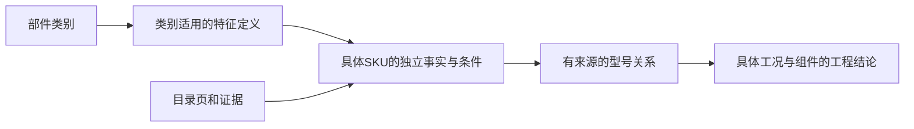

# 部件共性、差异与数据库设计

本轮把自由文本参数升级为受约束的部件特征模型。共性是“字段含义和规则可复用”，不是“同系列自动得到同样的值”。同一个数值也不代表可互配。

## 各类部件究竟共享什么

所有可订购部件共享身份、目录版本来源、包装、逐项证据和审核机制；型号与订货号分别保存，不用型号字符串替代实体身份。不同类别共享字段字典，但各类别可用字段不同。

| 类别 | 需要明确的独特特征 | 容易混淆的地方 |
| --- | --- | --- |
| 芯体 | 普通接点与PE、性别、端接、额定条件、线径、接点编号、装壳规格 | 10＋PE不是11个普通接点；Quick-in不是普通弹簧；HA-032不是单个SKU |
| 接触件 | 公母、镀层、适用导体截面、识别槽、剥线、压接工艺 | 1和1.5 mm²两个明确规格不代表中间所有线径都适用；普通接点数量不含PE |
| 电缆端外壳 | 芯体规格、进线方向、入口螺纹、锁紧结构、安装空间 | “10A”是规格代号，不是额定电流10 A；“M20”不证明螺距为1.5 mm |
| 面板/表面底座 | 安装形式、开孔/板厚、锁扣、密封及随件 | 裸芯体开孔不能用于面板底座；带盖和不带盖不是同一订货号 |
| 电缆接头 | 夹紧外径、螺纹/螺距/长度、材料、密封和静态/动态温度 | 线芯截面mm²与整缆外径mm不同；接头IP68不提升整套总成为IP68 |
| 工具 | 用于什么工序、接触件/线径/压模/定位条件 | 装配工具不是每套成品都消耗的配件；TL02G对0.37 mm²接触件有明确限制 |
| 编码件及其他附件 | 防错等功能、明确适用型号、是否选配及数量条件 | 目录明确适用CODE-Q3的型号不能扩展成整个HA系列；“可选”不等于默认必需 |
| 框架、密封件、线缆 | 槽位/安装、材料/密封状态、导体/绝缘/长度等专有字段 | 本轮只预留类别；专有字段和数据还需后续按原文扩充，不能称为这些类别已建库完成 |

同系列仍有独特属性。HA-003普通螺钉款与V2的线径不同；HA-004-V2缺少明确线径依据；普通弹簧和Quick-in的线径、剥线及接触电阻不同。型号名称相似不能替代这些区别。

## 数据分成五层

1. **类别与特征字典**：`component_categories`、`characteristic_definitions`、`category_characteristics`。当前10类部件、47个字段定义，其中8个映射现有身份列，39个为参数。规定含义、数值/整数/文本类型、规范单位、适用类别、部分端接条件、最小值及上下界对应关系。
2. **单件身份**：继续使用`products`。普通接点/PE等身份字段不在参数表重复创建。家族用于组织导航，不用于自动继承参数、认可配对或推导未知值。
3. **单件条件事实**：继续使用`product_specifications`作为唯一参数事实源。保留每个SKU、条件、来源和审核状态，避免建立另一套与旧库争夺真值的新参数表。
4. **关系与依赖**：继续使用`product_relations`。配对、适用接触件、装壳、必需和可选附件分别表达。特征相同或同页出现不能自动创建`mates_with`。
5. **组合与工程结论**：`catalog_arrangements`描述非SKU的编排；`assembly_requirements`描述组件角色和数量条件；`assembly_assessments`只对准确组件及工况生效。

不为“节省重复值”而合并各SKU的审核事实。共享字段定义可以归一化，数值恰好相同的两条事实仍要分别保留证据。将来增加共享参数模板，也必须有明确成员、适用条件及例外机制，不能以系列名做隐式默认。

## 已落地的数据库约束

- 参数名必须在字典登记，并适用于该部件类别；端接限定字段还要匹配端接方式。更改类别或端接时也会检查已有参数。
- 数值和文本二选一；禁止NaN/Infinity；包装量、寿命次数为整数。电流用A、电压用V、导体截面用mm2、外径用mm、扭矩用Nm等规范单位，不做静默换算。
- 同一SKU、同一条件下的线径、温度及外径上下界不能颠倒。写入时锁定该产品，避免并发修改上下界绕过检查。
- 条件必须是JSON对象；IEC/UL、污染等级、电位关系和公差等继续完整保留，不能只存一个“最大额定值”。当前不声称已经对所有条件键做完整业务语义校验。
- 适用字段中的`expected`表示资料检查应关注的字段，不表示缺失字段可默认通过，也不是所有场景下的强制工程规则。它不会生成产品事实。

### 未知、不适用和未录入

`product_specifications.value_state`支持：

| 状态 | 数据库要求 | 含义 |
| --- | --- | --- |
| known | 有且仅有数值或非空文本，类型与单位符合字典 | 已有目录记录；是否可信仍看参数及证据的审核状态 |
| unknown | 没有数值/文字值，必须有state_reason及来源 | 已明确发现尚不能确定，不填0或借用相邻型号 |
| not_applicable | 没有数值/文字值，必须有state_reason及来源 | 已明确不适用，不能只因为没找到就这样标记 |
| not_recorded | 查询时产生，不伪造一条参数事实 | 该适用字段尚无记录，后续应检查资料 |
| unreviewed / conflict | 查询按记录和来源状态显示 | 尚未审核或存在冲突，不能包装成确定事实 |

“值已知”和“审核通过”分开。即使审核确认了“该参数未知”，也没有一个可用于数值选型的额定值。选型器对未知范围、温度和额定值继续给待确认，不崩溃、不放行。审核页面允许修改值状态和原因，仍记录版本、修改前后值及依赖失效。

本轮不批量把旧库缺项填成未知，也不把旧资料包中的待确认参数自动写入库。新增列给原有事实标记known，仅表示它们已有值，不更改原pending审核状态。

## 共性与差异怎样查询

- `GET /component-schema`：查询类别与字段定义，可传`category=insert`等。
- `GET /products/{id}/characteristics`：单SKU的分类特征、独立来源、缺项和值状态。
- `POST /products/compare`：提交`{"product_ids":[1,2],"include_pending":true}`，只读比较2–20个不同产品ID；ID是示意，应先查库，不把数字当固定型号映射。

新特征查询默认要求身份和来源已审核；资料核对可显式`include_pending=true`。比较返回`common_in_this_comparison`和`different_or_unknown`。只有所有被比较SKU都明确有值，且类型、单位、数值/文字及整组适用条件一致，才列为本次比较共有项。每个SKU的来源和审核状态仍分别返回。

同为16 A但标准或条件不同，仍列为差异。一个型号有线径参数、另一个未录入，不会把已有参数传播给另一个。跨类别没有定义的字段显示`not_defined_for_category`，不把它当作经过审核的“不适用”结论。共有特征也不表示可互换、可配对或总成合格。

## 迁移、验证与后续

`wain.db.initialize`先保留原基础建表，再运行`wain.migrations`。`001_component_features.sql`和`data/component_schema.json`组成第一条校验和固定的迁移，记录在`schema_migrations`。已应用的迁移内容不能原地更改；未来扩字段应新增迁移。旧数据若不符合新约束，整次迁移回滚，不自动改数值或撤销已有审核。

操作入口：`python -m wain.migrations`。上线运行新接口前要先执行迁移；这是数据库升级，不是公开部署。真实库升级前做私有备份，升级后比对原身份、参数、证据、关系、编排及审核历史的内容摘要。

验证包含原库升级保值、重复迁移、类别/类型/单位/端接和范围拒绝、未知值审核和选型、条件敏感比较及只读接口。集成测试在事务内新schema回滚，不写业务批准。数据库备份恢复仍按README执行；本轮未实现自动反向迁移或假定它可无损删除新状态。

下一步是按系列继续补专有接口字段（如独立螺距、锁扣几何、尺寸基准、编码/针位）及有来源的实际适配关系，完善条件语义和工程规则。不能把统一字段字典当成这些数据已经齐全。
