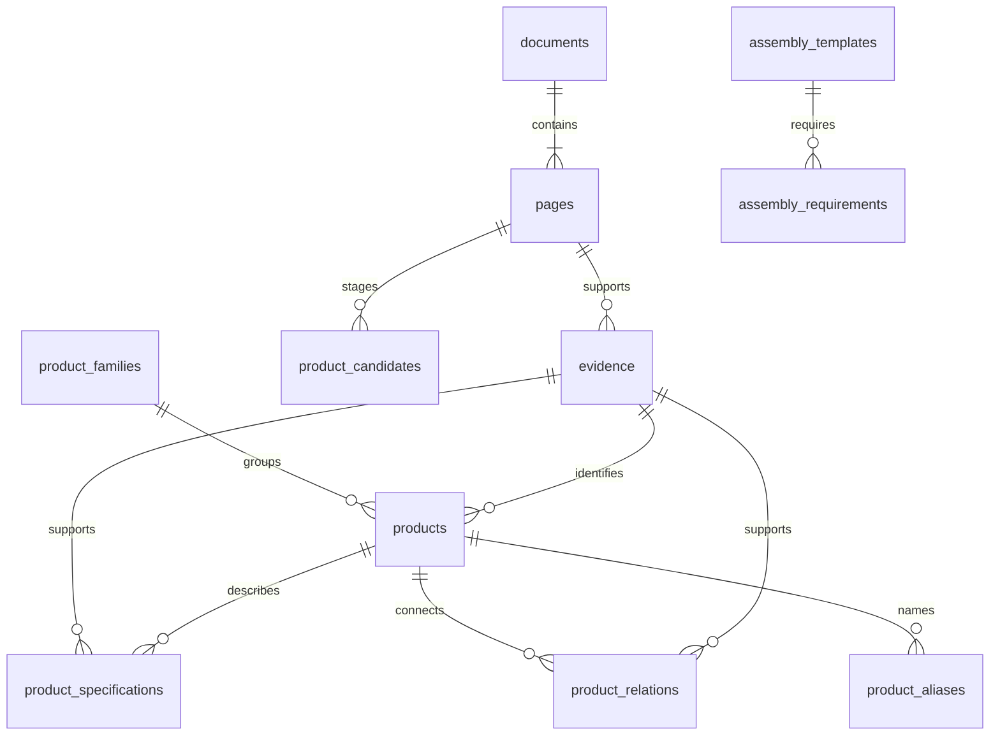

# 数据结构与后续 Agent 边界

## 来源

文档 SHA-256 防止文件内容变化后沿用旧来源。每页记录分卷页码和全书页序。
印刷编号只对已核对的样板页填写，不能把全书页序简单减去常量后生成所有章节编号。
证据区域为 `[x0, y0, x1, y1]`，坐标相对于页面宽高归一化到 0–1。
样板引用的是整块表格，不是自动识别的精确单元格。原文引用可能合并同一区域的几个字段，实际以页面图片为准。

## 状态

`product_candidates` 中的接受/拒绝只是审核工作流状态，当前程序没有自动提升候选的功能。
`products`、`product_specifications`、`product_relations`、`evidence` 分别维护状态，不能用某一项的审核结果替代其他项。
证据标记 reviewed 必须记录审核人和时间。当前样板全部 pending；没有预置 reviewed 数据。

默认产品搜索要求产品及其身份来源均 reviewed。附带额定参数过滤时，参数及参数来源也需 reviewed。
即使记录审核完成，它也只是可以参与后续求解的产品，不能直接代表一个完整方案通过。
详情接口和待审核接口会显式返回各字段状态；接入模型时必须保留这些状态及证据，不允许去掉后只传数字。

## 电气参数

额定电流和电压具有标准、污染等级及降额等条件。当前参数表保留条件 JSON，后续需要补充工况评估器。
例如 HA 技术页为 EN 61984 条件下的 16A、250V，但同时有线径与环境温度相关的载流曲线。
最小额定值筛选没有读取或求解这些曲线，所以 API 返回 `candidate_only=true`。
不从像素曲线自动编造电流点；曲线数字化和厂家确认是独立工作。

## 完整性

当前有一个未审核的电缆至面板方案模板和七项组件角色；它不是已经实现的完整性校验器。
64 条端子关系来自样板页对应端子表，仍待核验；没有因为型号相似而生成可直接使用的配对关系。
外壳、进线附件、密封条件、端子数量、PE 结构、装配工具要求仍需补齐。
完整方案求解器、校验器与大模型工具适配层均未实现，不能将数据库查询接口包装成“选型已通过”。

## 当前 API 的用途

产品筛选、资料定位、候选审核和后续模型接入的数据基础。
API 只绑定本机，生产发布前还需鉴权、限流、部署和备份策略；目前没有外部部署。
原始 OCR/目录文字应作为工具返回的数据字段，不能拼成系统指令，也不能执行其中的命令或链接。
