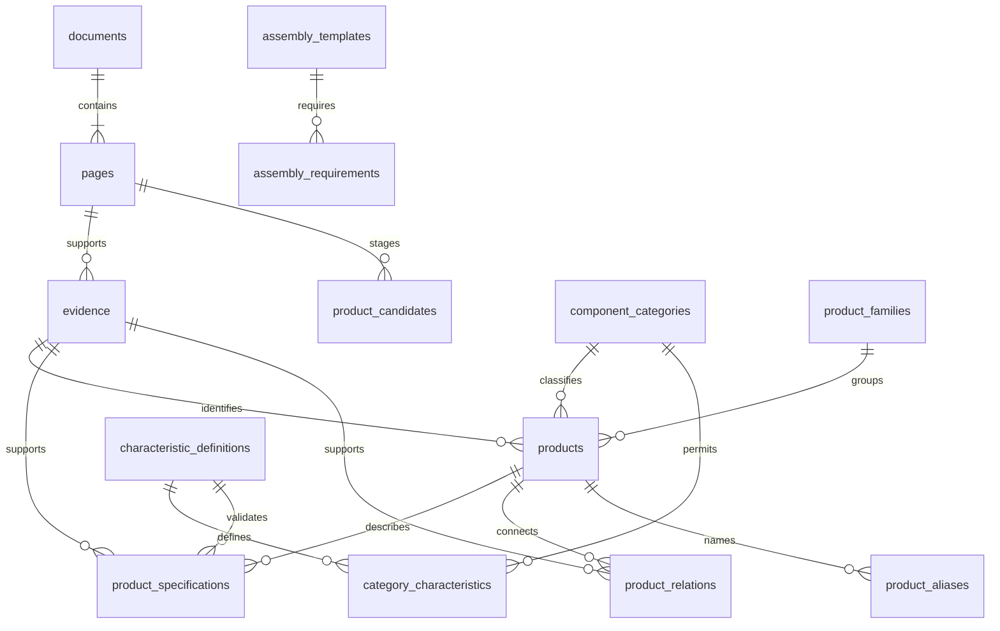

# 数据结构与后续 Agent 边界

部件共性/差异、10类47字段字典、值状态与迁移规则见 [部件特征模型](component-model.md)。参数事实仍以逐SKU、逐条件、逐证据存储，不按系列自动继承。

## 来源

文档 SHA-256 防止文件内容变化后沿用旧来源。每页记录分卷页码和全书页序。
印刷编号只对已核对的样板页填写，不能把全书页序简单减去常量后生成所有章节编号。
证据区域为 `[x0, y0, x1, y1]`，坐标相对于页面宽高归一化到 0–1。
样板引用的是整块表格，不是自动识别的精确单元格。原文引用可能合并同一区域的几个字段，实际以页面图片为准。

## 状态

`product_candidates` 中的接受/拒绝只是审核工作流状态，当前程序没有自动提升候选的功能。
`products`、`product_specifications`、`product_relations`、`evidence` 分别维护状态，不能用某一项的审核结果替代其他项。
证据标记 reviewed 必须记录审核人和时间。当前样板全部 pending；没有预置 reviewed 数据。

默认产品搜索要求产品及其身份来源均 reviewed。附带额定参数过滤时，参数及参数来源也需 reviewed。
即使记录审核完成，它也只是可以参与后续求解的产品，不能直接代表一个完整方案通过。
详情接口和待审核接口会显式返回各字段状态；接入模型时必须保留这些状态及证据，不允许去掉后只传数字。

## 电气参数

额定电流和电压具有标准、污染等级及降额等条件。当前参数表保留条件 JSON，后续需要补充工况评估器。
例如 HA 技术页为 EN 61984 条件下的 16A、250V，但同时有线径与环境温度相关的载流曲线。
最小额定值筛选没有读取或求解这些曲线，所以 API 返回 `candidate_only=true`。
不从像素曲线自动编造电流点；曲线数字化和厂家确认是独立工作。

## 完整性

当前有通用试验和 HA-010 专用两个模板。HA-010 校验器采用明确范围的组件角色与逐项检查。
64 条端子关系来自样板页对应端子表，仍待核验；没有因为型号相似而生成可直接使用的配对关系。
外壳、进线附件已补充六条样板，密封条件、PE 结构与真实型号配对仍需工程审核。
已实现候选 BOM、普通端子数量、参数条件、审核状态和必需附件依赖检查。
`assembly_assessments` 将降额、密封、PE 和针位安装结论绑定至完整工况及具体产品 ID；
资料变化会撤回工程结论，且旧结论不能沿用到不同工况。
所有必需检查通过时程序才可放行。实际数据全部待审核，目前没有已确认的真实组合。
大模型工具适配层尚未实现，不能将候选查询结果包装成“选型已通过”。

## 目录导航与产品表分开

`catalog_groups` 和 `catalog_sections` 保存总目录分类、条目和原文范围，参考索引和规格类别也可作为导航条目。
它们不向 `product_families` 或 `products` 自动写入任何型号。
`catalog_family_links` 以明确的家族代码连接现有样板；允许产品家族尚未建库时保留导航定义。
`catalog_page_labels` 保存页脚 OCR 候选和已有页面标签的观察来源，不修改 `pages.printed_page`。
同一标签在多页出现时显式保留冲突，没有锚点时保持未知，不推算统一偏移。
样板数量没有完整 SKU 总数作为分母，因此不能解释为系列建库百分比。

## HA 订货表与编排

`product_source_occurrences` 保留同一订货号在不同订货页中的出现，以及其上下文。例如同一 HA-016
既用于独立芯体页，也在 HA-032 编排页列出；物理产品不因跨页重复增加。
本章订货表行数的分母是人工逐页转录的 147 行，不能外推成全目录产品总数。

`catalog_arrangements` 和 `catalog_arrangement_components` 表示 HA-032 的两半芯体编排，不是可采购 SKU。
32 接点编排不能让单个 HA-016 半组的普通接点数变成 32；单件物理规格、组合壳体引用与订货身份分别保存。
编排、来源转录和实际工程批准是三个不同概念。

小型 HA 的导体对地/导体对导体额定电压、替代标识和 UL 数值分开存储。通用 `rated_voltage`
筛选不自动把这些字段取最大值；需要明确标准和电位关系后再扩展求解，不得直接用于未支持系列的放行。
`spring_quick_in` 与普通 `spring` 使用不同线径、剥线和接触电阻参数。
未明确的 HA-002 普通/PE 接点数和 HA-004-V2 线径上限保持未知。

## 当前 API 的用途

产品筛选、资料定位、审核、HA-010 候选 BOM 及后续模型接入的数据基础。
API 只绑定本机，生产发布前还需鉴权、限流、部署和备份策略；目前没有外部部署。
原始 OCR/目录文字应作为工具返回的数据字段，不能拼成系统指令，也不能执行其中的命令或链接。
